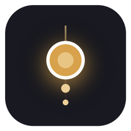

# 物語 · Monogatari

*Tell your story, and in the telling, come to know yourself again.*

**Monogatari** ("tale") is a suite of private, trauma-informed apps for mental health through
**reconnaissance**: *re-knowing* yourself by documenting your life and reading it back. It is
built on one belief: that authoring your own story, honestly and beautifully, is one of the
deepest ways to process what has happened, make meaning of it, and build lasting self-assuredness.

## The apps

| | App | Runs on | For |
|---|---|---|---|
| ストーリー | **[Sutōri](https://github.com/R0N1N9/sutori)** | Desktop (macOS, Windows, Linux) and the web | Interactive stories and timelines of your life. Write chapters beside your own photos, placed by the day each was taken; in time, feed it your moments and it narrates your story back. |
| 俳句 | **[Haiku](https://github.com/R0N1N9/haiku)** | Android | The short form: a 30-second check-in, a three-line reflection, a safety plan in your pocket. |

An *epic* is the long tale you build with room to breathe; a *haiku* is one moment caught in
passing. What you capture in Haiku is meant to flow into Sutōri's timeline, through your own
Google Drive.

## What they stand for

- **Your story is yours.** Stored on your own devices, encrypted. No telemetry, no accounts of
  ours, no server holding anyone's writing. Cloud sync, when you turn it on, goes to *your own*
  Google Drive.
- **Healing by design.** You set the pace, nothing is forced, and grounding and crisis resources
  are always one tap away.
- **Gentle, never coercive.** No streaks, no guilt, no dark patterns.
- **Beautiful by default.** Writing and reading your life should feel like craft, not data entry.

These apps support reflection and resilience **alongside** real-world support and professional
care. They are not therapy and never replace it.

## What lives here

This repository is the suite's home; the apps' code lives in their own repositories.

| | |
|---|---|
| [`docs/VISION.md`](docs/VISION.md) | The idea, the two apps, design principles, trauma-informed commitments |
| [`docs/ROADMAP.md`](docs/ROADMAP.md) | What's done and what's next, for each app and for syncing between them |
| [`docs/SAFETY.md`](docs/SAFETY.md) | The safety stance and crisis resources |
| [`spec/`](spec/) | The shared story format the apps use to exchange your story (draft), with test cases any language can run |
| [`design/`](design/) | The early interactive design explorations (Candlelight, Dawn, Nocturne) |

## For anyone in crisis

Neither app is an emergency service. If you or someone you know may be in danger, please reach out
to local emergency services or a crisis line. In the US you can call or text **988** (Suicide &
Crisis Lifeline). More in [`docs/SAFETY.md`](docs/SAFETY.md).
