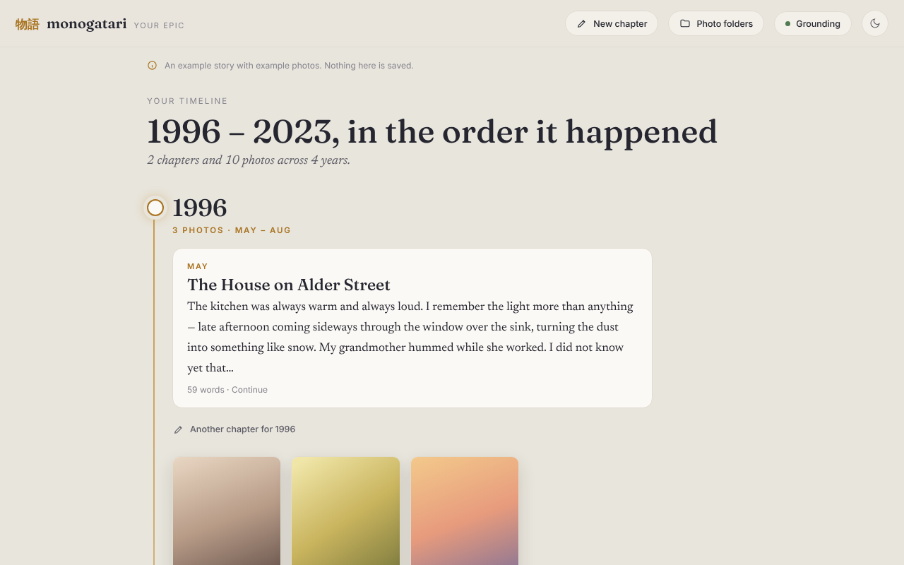
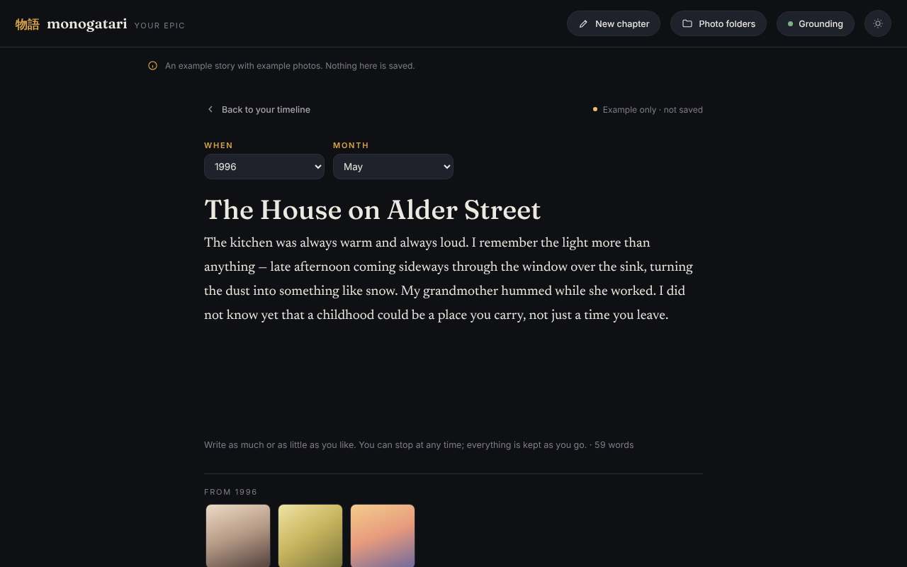

<p align="center"></p>

<h1 align="center">物語 · monogatari</h1>

<p align="center"><i>A beautiful, private place to tell the story of your life — and in the telling, to re-know yourself.</i></p>

<p align="center">
  
  <br><sub>Your timeline: chapters you write, beside photos placed by the date each was taken. (Browser preview with an example story and drawn example photos.)</sub>
</p>

monogatari (Japanese: "story / narrative") is a cross-platform desktop companion for mental
health through **reconnaissance** — *re-knowing*. It is built around a single belief: that
authoring your own story, honestly and beautifully, is one of the deepest ways to process
what has happened, make meaning of it, and build lasting self-assuredness.

It is a tool for reflection and resilience. It stands **alongside** real-world support and
professional care — it never replaces them.

---

## What it is

You write the chapters of your life. You point monogatari at a folder of your photographs,
and it reads each image's capture date and arranges them along your timeline automatically —
so your visual history assembles itself into your narrative. The result is less a diary than
an **illuminated manuscript of your own epic**.

## Features

- **Write the chapters of your life**, each placed at a year (and optionally a month) on a candlelit timeline, with
  gentle prompts if you want a place to begin.
- **Photos arrange themselves.** Choose a folder or a whole drive; monogatari reads each photo's capture date (EXIF)
  and lays it along your timeline, year by year. It remembers your folders. Photos are only ever read.
- **Open any photo** to see the moment it was taken, and walk through time with ← and →.
- **Encrypted, crash-safe storage** on your computer, with the key in the system keychain and rolling backups.
- **Grounding** is always one click away in the top bar, with crisis lines. **Light and dark** modes.
- No network connections and no telemetry.

## Screenshots

| | |
|---|---|
|  |  |
| **Writing a chapter** (dark mode), with that year's photos below. | **Grounding**: a breathing guide and crisis lines, always in the top bar. |

Screenshots are from the browser preview (`npm run dev`), which uses a fictional example story and drawn example photos.

## What it stands for

- **Your story is yours.** Everything is stored on your own computer, encrypted. No telemetry.
  Nothing leaves your laptop unless *you* choose to — and if you turn on cloud saving, it goes to
  your own Google Drive, never to a server of ours.
- **Beautiful by default.** The writing is the centerpiece and it should feel like craft, not
  data entry.
- **Healing by design.** Trauma-informed throughout: you set the pace, nothing is forced,
  grounding and crisis resources are always one click away.
- **Runs everywhere.** macOS, Windows, and Linux, from a single small, fast install.

## Status

**Working today:** write the chapters of your life on a candlelit timeline, beside your photos
arranged by the date each was taken.

This repository is the **desktop app** (Mac, Windows, Linux): everything encrypted on your
computer. How to get it: [`docs/RUN.md`](docs/RUN.md)

**The family:**

| | |
|---|---|
| **monogatari** (物語) | This repository. The desktop app: the full epic, whole drives of photos, encrypted on your computer. |
| **[sutori](https://github.com/R0N1N9/sutori)** (ストーリー) | The website: sign in with Google and your story is saved to your own Google Drive. |
| **haiku** (俳句) | The Android companion, for capturing moments on the go. |

All three share one story format.
- **The full concept:** [`docs/VISION.md`](docs/VISION.md)
- **The plan:** [`docs/ROADMAP.md`](docs/ROADMAP.md)

## Getting started

Installers for macOS, Windows and Linux are built by GitHub Actions; [`docs/RUN.md`](docs/RUN.md) explains how to
download and open them.

For development (Node 22+, Rust stable, and WebKitGTK on Linux):

```bash
npm install
npx tauri dev        # the desktop app, with live reload
npm run dev          # only the interface, in a browser, with example photos
npm test             # story model and timeline
cargo test -p photo_core -p vault_core   # photo engine and encrypted storage
```

## Tech and structure

Tauri 2 (Rust) desktop shell with a React + TypeScript interface built with Vite.

| Path | What it is |
|---|---|
| `crates/photo_core/` | Photo engine: scans folders, reads EXIF capture dates, orders and groups photos |
| `crates/vault_core/` | Encrypted, crash-safe story storage with rolling backups and damage recovery |
| `src-tauri/` | The native shell: exposes the engines, keeps the key in the system keychain |
| `src/` | The interface (React + TypeScript), in the Candlelight design; `src/story/` is the shared story model |
| `spec/` | The story format shared with sutori and haiku |
| `design/` | Interactive design previews (Candlelight, Dawn, Nocturne) |
| `e2e/` | End-to-end tests that drive the real desktop app |

More detail: [`docs/RUN.md`](docs/RUN.md).

## For anyone in crisis

monogatari is not an emergency service. If you or someone you know may be in danger, please
reach out to local emergency services or a crisis line. In the US you can call or text **988**
(Suicide & Crisis Lifeline). A fuller list lives inside the app and in
[`docs/SAFETY.md`](docs/SAFETY.md).
